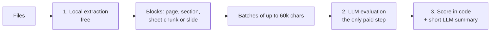

# Document Curation API — case study

A FastAPI service that checks whether a document is good enough to go into a RAG knowledge base. It reads PDF, Word, Excel and PowerPoint files, scores them against 24 quality criteria, and explains what to fix before indexing.

> The code belongs to my employer, a large Brazilian insurer. This case study describes the problem, the design and the decisions. Names, documents and data shown here are fictional.

## Context

Many generative AI agents in the company answered from document bases: policies, manuals, FAQs and rule spreadsheets. When an answer was wrong, the cause was often the document, not the model: vague cross-references ("as mentioned above"), generic titles, facts split across slides, outdated versions. Teams needed a way to check documents **before** indexing them.

## What it does

- Accepts `pdf`, `docx`, `xlsx`, `xlsm` and `pptx`, several files per request.
- Extracts text locally, with no OCR, embeddings or indexing.
- Evaluates the content against **24 criteria: 14 mandatory and 10 desirable**. Examples: sentences that make sense on their own, descriptive section titles, cohesive paragraphs, an explicit current version, a named owner.
- Computes a **deterministic score** and classification in code.
- Writes a short narrative opinion with the main fixes.
- Never changes or stores the documents.

## Pipeline



| Format | Library | Block |
|---|---|---|
| PDF | PyMuPDF | one per page with text |
| Word | python-docx | one per section (title to next title), plus one per table |
| Excel | openpyxl | one per sheet, split every 100 rows |
| PowerPoint | python-pptx | one per slide |

## Key decisions and trade-offs

| Decision | Why | Trade-off |
|---|---|---|
| **Extract first, count batches, then decide** | Size in pages or rows says little; the number of LLM batches drives time and cost | Extraction always runs, even for files that end up refused |
| **Two size limits**: above 60 batches, only the first 60 are evaluated and the rest are marked "not evaluated"; above 180, the file is refused before any AI call | Keeps each document inside a ~10-minute response budget, and huge files cost nothing | Very long documents get a partial review |
| **Compact model output**: criteria with no problem return only `id` + `status`; only problems carry a justification | Output tokens are the expensive part | The model sometimes needs a retry when it mixes both formats |
| **Score computed in code** from the per-criterion results | Reproducible, explainable scores; the model only judges each criterion | Weighting changes need a code change |
| **One shared parallelism cap** across all files in a request (10 concurrent calls) | Protects the gateway's rate limits regardless of upload size | Big multi-file uploads are slower |

## Quality

- **111 automated tests**, gateway calls mocked, including corrupted files, wrong extensions and invalid bytes that must not break the rest of the batch.
- Per-batch retries with backoff, and polling with a timeout for each gateway workflow.

## Illustrative snippet

```python
def plan_batches(blocks: list[str], max_chars: int = 60_000) -> list[str]:
    batches, current = [], ""
    for block in blocks:
        if current and len(current) + len(block) > max_chars:
            batches.append(current)
            current = ""
        current += block + "\n\n"
    return batches + ([current] if current else [])

batches = plan_batches(extract_blocks(file))
if len(batches) > HARD_LIMIT:            # 180: refuse before spending tokens
    return Refused(reason="too large", batches=len(batches))
to_evaluate = batches[:SOFT_LIMIT]       # 60: evaluate the first part only
```

## Stack

Python · FastAPI · Pydantic · PyMuPDF · python-docx · openpyxl · python-pptx · PyJWT · requests · pytest · Azure API Management
