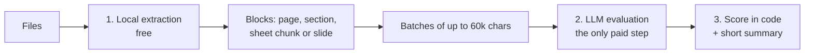

# Document Curation API

Scores PDF, Word, Excel and PowerPoint files against 24 quality criteria before they enter a RAG knowledge base, so teams fix the document instead of blaming the model.

**Stack:** Python · FastAPI · Pydantic · PyMuPDF · python-docx · openpyxl · python-pptx · pytest (111 tests)
**Role:** Lead developer: design and implementation
**Status:** In production

> Built at a large Brazilian insurer. The company is replaced by the fictional **Acme Seguros**, and every name, document and data point here is fictional. Code, prompts and UI are in Portuguese, written for Brazilian business teams.

## Problem

Many of the company's AI agents answered from document bases. When an answer was wrong, the cause was often the document: vague cross-references ("as mentioned above"), generic titles, facts split across slides, outdated versions. Teams needed to check documents **before** indexing them.

## What I built



- **24 criteria, 14 mandatory and 10 desirable**, for example: sentences that make sense on their own, descriptive section titles, an explicit current version, a named owner.
- **Format-aware blocks:** one per PDF page, Word section or table, 100-row Excel chunk, or slide.
- **Token budgeting:** large files are capped or refused before any AI cost is spent.
- **Deterministic score and classification computed in code**; the model only judges each criterion.
- Documents are never changed or stored.

Full write-up with trade-offs: [docs/CASE_STUDY.md](docs/CASE_STUDY.md)

## Run it

```bash
python -m venv .venv && .venv\Scripts\activate   # macOS/Linux: source .venv/bin/activate
pip install -r requirements.txt
pytest                                             # 111 tests, no keys needed
cp .env.example .env                               # gateway URL + Entra ID app
uvicorn src.main:app --reload                      # Swagger at /docs
```

---
Part of my [AI engineering portfolio](https://github.com/lucasboliveirasipp).
